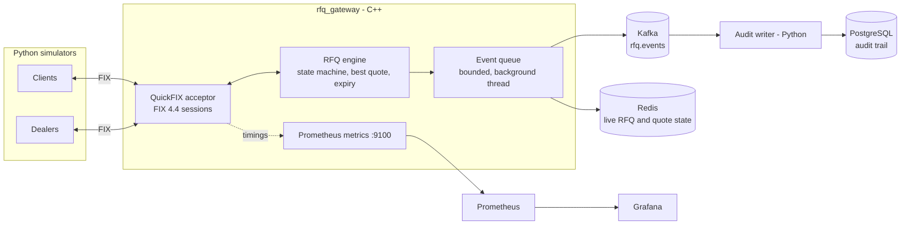
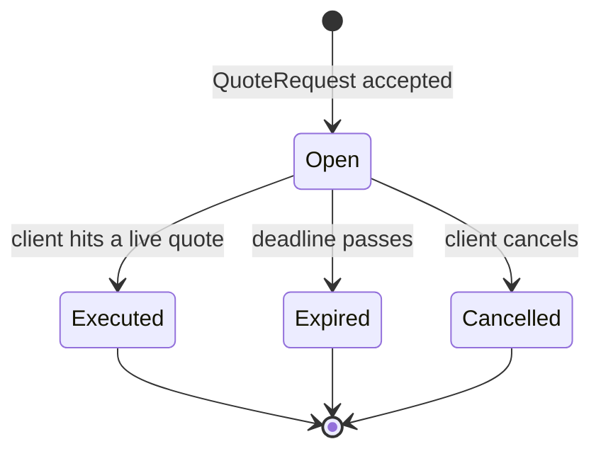

# Low-Latency RFQ Trading Simulator

An event-driven **Request-for-Quote (RFQ)** workflow, built end to end: a client asks several dealers for a price, the dealers quote, the client hits the best quote, and the trade executes. The matching and quoting engine and the FIX gateway are written in C++20. Events stream through Kafka, live state sits in Redis, an audit trail lands in PostgreSQL, and Prometheus and Grafana show latency percentiles, throughput and error rates. Python simulators play the dealers and clients, and double as a load generator that gates CI.

> **What is real and what is simulated.** The engine, the FIX 4.4 session layer (QuickFIX), the Kafka/Redis/PostgreSQL pipeline and the metrics are real and tested. The dealers, the clients and the market prices are simulated. There is no connection to any real venue.

## Contents

1. [How it works](#how-it-works)
2. [Architecture](#architecture)
3. [The RFQ lifecycle and FIX messages](#the-rfq-lifecycle-and-fix-messages)
4. [Components](#components)
5. [Quick start](#quick-start)
6. [Running the simulation](#running-the-simulation)
7. [Observability](#observability)
8. [Testing](#testing)
9. [Performance](#performance)
10. [Design decisions](#design-decisions)
11. [Limitations](#limitations)
12. [Repository layout](#repository-layout)
13. [CI](#continuous-integration)

## How it works

```
Client ──QuoteRequest──▶ Gateway ──QuoteRequest──▶ Dealer A, B, C ...
Client ◀──Quote──────── Gateway ◀──Quote──────── Dealers
Client ──QuoteResponse (hit)──▶ Gateway ──ExecutionReport──▶ Client + winning dealer
```

1. A client sends a FIX `QuoteRequest` (instrument, side, size, expiry).
2. The gateway creates the RFQ in the engine and forwards the request to every dealer that is logged on.
3. Each dealer answers with a `Quote`. The engine validates it (invited dealer, full size, not expired) and the gateway relays it to the client.
4. The client sends a `QuoteResponse` to hit one quote. The engine checks the RFQ and quote are still live and executes.
5. Both sides get an `ExecutionReport`. The other invited dealers are told the RFQ traded away. Unanswered RFQs expire, and the client and dealers are told.

Every state change also produces an **event** (created, quoted, withdrawn, superseded, executed, expired, cancelled). Events are queued off the hot path and published to Kafka (the durable stream) and Redis (the live state). A separate writer replays the Kafka stream into PostgreSQL as the audit trail.

## Architecture



| Layer | Technology | Role |
|-------|------------|------|
| Engine | C++20, no I/O | RFQ state machine, quote book, best-quote selection, expiry. Single-threaded and deterministic. |
| Connectivity | C++ with QuickFIX 1.16 | FIX 4.4 sessions for clients and dealers; translates messages to engine calls. |
| Event bus | Kafka (librdkafka) | Ordered, durable event stream, keyed by RFQ id. |
| Live state | Redis (hiredis) | Current state of open RFQs and quotes, with a TTL after an RFQ finishes. |
| Audit trail | PostgreSQL (psycopg) | Append-only event log plus projected `rfqs`, `quotes` and `executions` tables. |
| Metrics | prometheus-cpp, Prometheus, Grafana | Latency percentiles, throughput, error rate, pipeline health. |
| Simulators | Python asyncio, simplefix | Dealer and client FIX sessions, open-loop load generator. |
| Tests | GoogleTest, pytest | Unit, integration, end-to-end and load tests. |
| Local infra | Docker Compose | Kafka, Redis, PostgreSQL, Prometheus, Grafana. |

## The RFQ lifecycle and FIX messages

An RFQ is always in one of four states:



Quote rules enforced by the engine:

- Only dealers invited to the RFQ can quote.
- A quote must cover the full requested size (partial fills are not supported).
- A new quote from a dealer replaces that dealer's previous active quote. The old quote is recorded as superseded, not withdrawn, and the client is told it was replaced.
- When a dealer logs out, its live quotes are withdrawn, so a client cannot hit a price that nobody is there to honour.
- A quote's validity is capped at the RFQ's expiry.
- The best quote is the lowest price for a client buying and the highest for a client selling. On equal prices the earlier quote wins.
- Nothing can be quoted or executed once an RFQ is closed or past its deadline, even if the periodic expiry sweep has not run yet.

FIX 4.4 message map:

| Direction | Message (35=) | Meaning |
|---|---|---|
| client to gateway | `QuoteRequest` (R) | Start an RFQ. Group: Symbol, Side, OrderQty, optional ExpireTime. |
| gateway to dealers | `QuoteRequest` (R) | Same request, re-keyed with the gateway's RFQ id. Client identity is not forwarded. |
| dealer to gateway | `Quote` (S) | Price. `OfferPx`/`OfferSize` when the client buys, `BidPx`/`BidSize` when it sells. |
| gateway to client | `Quote` (S) | The relayed quote, keyed by the client's own `QuoteReqID`. |
| client to gateway | `QuoteResponse` (AJ) | `QuoteRespType=1` (hit) plus the `QuoteID` to trade. |
| gateway to client and winning dealer | `ExecutionReport` (8) | `ExecType=F` (trade). The dealer sees the opposite side. |
| dealer to gateway | `QuoteCancel` (Z) | Withdraw one quote by the dealer's own `QuoteID`. |
| client to gateway | `QuoteCancel` (Z) | Cancel the RFQ by `QuoteReqID`. Client receives `ExecType=4`. |
| gateway to client | `ExecutionReport` (8) | `ExecType=C` (expired) when the deadline passes. |
| gateway to client | `QuoteStatusReport` (AI) | A quote the client was shown is gone: withdrawn, replaced, or its dealer disconnected. `QuoteStatus=6`, reason in `Text`. |
| gateway to dealers | `QuoteStatusReport` (AI) | The RFQ closed without trading with this dealer: traded away or cancelled (`QuoteStatus=6`), or expired (`QuoteStatus=7`). Carries the dealer's own `QuoteID` if it quoted. |
| gateway to anyone | `BusinessMessageReject` (j) | Invalid request, wrong role, unknown id, closed RFQ, and so on, with a reason in `Text`. |

Each FIX session has a `Role` (`CLIENT` or `DEALER`) in [config/gateway.cfg.in](config/gateway.cfg.in). The gateway refuses messages that do not fit the role, and a client cannot hit another client's quote. An `ExpireTime` more than 300 seconds away is rejected; without one the RFQ lives 10 seconds. The config defines eight client sessions (`CLIENT1`..`CLIENT8`) and eight dealer sessions (`DEALER1`..`DEALER8`).

## Components

### RFQ engine: [src/engine](src/engine)
Pure logic with no networking, disk or threads. The caller passes the current time into every call, which keeps it deterministic and easy to test. Prices are fixed-point integers (1e-6 units). Expiry uses a time-ordered index, so a sweep touches only overdue RFQs. Every state change calls an event sink with a sequence number and timestamp. An optional id base keeps ids unique across restarts. Closed RFQs are freed with `erase`, which the gateway calls as soon as it has sent the final reports, so memory stays flat over a long run.

### FIX gateway: [src/fix](src/fix)
`FixGateway` implements the QuickFIX `Application` interface and translates between FIX and the engine. All entry points share one mutex, so the engine is never used concurrently even though sessions and the expiry timer run on different threads. Quotes are relayed at the engine's stored fixed-point price, so the price a client sees is exactly the price it trades at. It reports timings and outcomes through a small `GatewayObserver` interface, so FIX logic does not depend on Prometheus. The gateway can be driven in unit tests with a fake sender and fake clock, with no sockets.

### Event pipeline: [src/messaging](src/messaging) and [src/store](src/store)
- `EventDispatcher` is a bounded queue drained by one background thread. The engine thread only enqueues. If the queue is full the event is dropped and counted rather than blocking trading. A consumer that throws is counted and does not stop the others.
- `KafkaEventPublisher` sends each event as JSON to `rfq.events`, keyed by RFQ id so one RFQ stays ordered in one partition. Idempotence is enabled.
- `RedisStateStore` keeps `rfq:{id}` (state, client, instrument, side, size, expiry, execution details), `rfq:{id}:quotes` and `quote:{id}` hashes, and expires them an hour after the RFQ finishes. Commands use argument vectors, so values are never interpolated into a command string. If the connection drops (for example Redis restarts) it reconnects and retries the command once, which is safe because every command it sends is idempotent.
- `event_codec` converts events to and from JSON and returns nothing for malformed input.

Event example:

```json
{"seq": 41, "ts": 1793900000123000000, "type": "QUOTE_RECEIVED", "rfq_id": 7432019, "quote_id": 7432021,
 "dealer_id": "DEALER2", "price": 99512000, "qty": 5000000, "valid_until": 1793900004123000000}
```

Event types: `RFQ_CREATED`, `QUOTE_RECEIVED`, `QUOTE_WITHDRAWN`, `QUOTE_SUPERSEDED` (carries `replaced_by`), `RFQ_EXECUTED`, `RFQ_EXPIRED`, `RFQ_CANCELLED`.

### Audit writer: [audit](audit)
A Python Kafka consumer that writes to PostgreSQL:

- **At-least-once and idempotent.** Offsets are committed only after the database write succeeds. Each event is stored under `(topic:partition, offset)`, so a redelivered message is detected and skipped.
- **Dead letters.** A message that cannot be parsed or applied (bad JSON, unknown type, a quote for an RFQ that does not exist) goes to `rfq_events_dead` and the writer carries on. A lost database connection still stops it, so Kafka replays the messages.
- **Projections.** Besides the append-only `rfq_events` log it maintains `rfqs`, `quotes` and `executions`. Schema: [audit/schema.sql](audit/schema.sql).

### Simulators and load generator: [sims](sims)
- `fix.py` is a small asyncio FIX 4.4 initiator with logon, heartbeats and sequence numbers.
- `dealer.py` simulates dealers quoting around a shared random-walk price with random delays and an optional no-quote rate.
- `loadgen.py` runs clients at a fixed rate (open loop, so slow replies do not slow the offered load), hits the best quote and reports p50/p90/p99/p99.9 for time to first quote, hit to execution, and RFQ to execution. It exits non-zero when a configured error-rate or p99 limit is breached.

## Quick start

### Prerequisites

- A C++20 compiler (MSVC 2022 or newer, GCC 11+, or Clang 14+), CMake 3.20+
- [vcpkg](https://github.com/microsoft/vcpkg) for the C++ dependencies (QuickFIX, librdkafka, hiredis, nlohmann-json, prometheus-cpp). They are listed in [vcpkg.json](vcpkg.json) and installed automatically on first configure. The first configure takes several minutes.
- Docker with Compose, and Python 3.12+

### 1. Build

```bash
git clone <this repo> && cd "Trading Simulator"

cmake -S . -B build -DCMAKE_TOOLCHAIN_FILE=<vcpkg-root>/scripts/buildsystems/vcpkg.cmake
cmake --build build --config Release
```

On Windows the binaries land in `build\Release\`. On Linux they are in `build/`.

### 2. Start the infrastructure

```bash
docker compose -f deploy/docker-compose.yml up -d
```

| Service | Address |
|---|---|
| Kafka | `localhost:9092` |
| Redis | `localhost:6379` |
| PostgreSQL | `localhost:5432` (db `rfq_audit`, user `rfq`) |
| Prometheus | http://localhost:9090 |
| Grafana | http://localhost:3000 (`admin` / `admin`) |

These credentials are for the local stack only.

### 3. Set up Python

```bash
python -m venv .venv
.venv/bin/pip install -r requirements.txt          # Windows: .venv\Scripts\pip
```

## Running the simulation

Use four terminals.

**Gateway** (FIX acceptor on port 5001, metrics on 9100):

```bash
build/Release/rfq_gateway build/gateway.cfg localhost:9092 127.0.0.1 9100
#                          ^config           ^kafka          ^redis    ^metrics port
```

Use `none` for Kafka or Redis to disable them, and `0` as the metrics port to disable metrics.

**Audit writer** (run from the `audit` folder):

```bash
cd audit
../.venv/bin/python -m audit_writer.main            # Ctrl+C to stop
```

**Load**:

```bash
.venv/bin/python -m sims.loadgen --dealers 4 --clients 2 --rate 100 --duration 30
```

Useful options: `--no-quote-rate 0.2` (dealers ignore 20% of requests), `--window-ms 100` (how long a client waits for quotes), `--json out.json`, `--max-error-rate 0.01`, `--max-p99-ms 150`.

Example output:

```
sent=3998 executed=3998 errors=0 (error rate 0.00%) throughput=199.9/s
latency (ms)        p50      p90      p99    p99.9      max
first_quote       8.345    14.05   21.986    38.98   47.011
hit_to_exec       2.078    4.621    8.562   14.652   18.171
rfq_to_exec      12.766   21.682   31.144   53.134   68.242
```

Open the Grafana dashboard at http://localhost:3000/d/rfq-overview while the load runs.

To check what reached PostgreSQL:

```sql
SELECT state, count(*) FROM rfqs GROUP BY state;
SELECT count(*) FROM rfq_events;
SELECT count(*) FROM rfq_events_dead;   -- should stay 0
```

There is also `rfq_demo`, which drives the engine directly (no FIX) and publishes simulated RFQs to Kafka and Redis: `rfq_demo <brokers> <redis-host|none> <rfq-count> [topic]`. And `engine_bench` measures the engine alone.

## Observability

The gateway exposes Prometheus metrics on `:9100/metrics`. Prometheus scrapes it (see [deploy/prometheus.yml](deploy/prometheus.yml)) and Grafana provisions the datasource and the **RFQ Gateway** dashboard automatically ([deploy/grafana](deploy/grafana)).

| Metric | Type | Meaning |
|---|---|---|
| `rfq_message_processing_seconds{msg_type}` | histogram | Time the gateway spends handling one inbound FIX message, including the engine decision |
| `rfq_time_to_first_quote_seconds` | histogram | RFQ received to first dealer quote relayed |
| `rfq_time_to_execution_seconds` | histogram | RFQ received to execution |
| `rfq_requests_total`, `rfq_quotes_total`, `rfq_executions_total`, `rfq_expired_total`, `rfq_cancelled_total` | counters | Throughput and outcomes |
| `rfq_rejects_total{reason}` | counter | Rejected messages by reason |
| `rfq_open_rfqs`, `rfq_dealers_online` | gauges | Current state |
| `rfq_dispatcher_dropped_events_total`, `rfq_dispatcher_consumer_errors_total` | counters | Health of the Kafka/Redis event queue; both should stay at zero |

The dashboard shows throughput, an error-rate tile (rejects plus expiries per RFQ), p50/p95/p99 for each histogram, p99 by FIX message type, rejects by reason, open RFQs, dealers online and pipeline health. A test checks that every metric the dashboard queries is actually exported.

The metrics port is bound on all interfaces so Prometheus in Docker can reach it. Do not expose it publicly.

## Testing

| Suite | How to run | What it covers |
|---|---|---|
| C++ unit tests | `ctest --test-dir build -C Release` | Engine rules, event codec, dispatcher, FIX gateway (fake sender and clock), metrics |
| C++ integration | set `RFQ_REDIS_HOST=127.0.0.1` and `RFQ_KAFKA_BROKERS=127.0.0.1:9092`, then `ctest -L integration` | Redis projection and Kafka publishing against the Docker stack |
| Python simulators and gateway end-to-end | set `RFQ_GATEWAY_EXE` and `RFQ_GATEWAY_CFG`, then `python -m pytest` from the repo root | FIX client library, dealer logic, dashboard consistency, and the real gateway driven over FIX, including the load gate failing on an impossible budget |
| Audit writer | `python -m pytest` in `audit/`; set `RFQ_PG_DSN` for the PostgreSQL tests, plus `RFQ_DEMO_EXE` and `RFQ_KAFKA_BROKERS` for the pipeline test | Projection logic, idempotence, dead letters, and the full engine to Kafka to PostgreSQL path with exact event counts |

Tests that need the Docker stack or built binaries skip themselves when their environment variables are not set.

Current count: 63 C++ tests (3 integration), 12 Python tests for the simulators and gateway, and 12 for the audit writer.

## Performance

Measured on a Windows development machine, MSVC Release build, everything on one host with the Docker stack running. Treat these as indicative, not as a benchmark of any particular hardware.

**Engine alone** (`engine_bench`, 200,000 RFQs each with 4 quotes and an execution):

| Operation | p50 | p99 |
|---|---|---|
| `submit_rfq` | 0.3 µs | 0.7 µs |
| `submit_quote` | 0.3 µs | 0.7 µs |
| `execute` | 0.1 µs | 0.2 µs |

About 310,000 complete RFQs per second on one thread. With the event queue attached to the engine thread it is about 1 µs per operation and 137,000 RFQs per second. JSON encoding costs about 2.6 µs per event but runs on the background thread, not the engine thread. The p99.9 and maximum values in the benchmark are dominated by operating-system scheduling pauses, not by the engine.

**Through the FIX gateway** (Python simulators; Kafka and Redis connected unless noted):

| Measure | Result |
|---|---|
| Gateway handling time per FIX message, disk-backed FIX store (the old default) | p50 0.30 to 1.29 ms, p99 3.9 to 9.8 ms (3 runs, Kafka and Redis off) |
| Gateway handling time per FIX message, current default (in-memory FIX store) | p50 0.14 to 0.20 ms, p99 1.0 to 1.3 ms (3 runs, Kafka and Redis off) |
| Load gate run: 4 dealers, 2 clients, 200 RFQs/s for 20 s | 3,998 of 3,998 executed, p99 RFQ-to-execution 31 ms |
| Heavier run: 3 clients at 150 RFQs/s each (about 450/s) | 6,744 of 6,744 executed, 0 errors, p99 RFQ-to-execution 31 ms |

How to read these:

- The engine's decision is sub-microsecond. The gateway's 0.14 to 0.20 ms per message is mostly FIX encoding, session handling and fanning a request out to several dealers. The engine is not the bottleneck.
- The end-to-end figures include the single-threaded Python simulators and a dealer response delay of 0.5 to 3 ms, so they overstate what the C++ side costs.
- These numbers were measured before the gateway started sending `QuoteStatusReport` notifications, which add one message per losing dealer per RFQ. Rerun the load generator to refresh them.
- The CI load gate runs the gateway with Kafka and Redis off, so it checks the FIX path only. The local runs above had them connected.
- The audit writer sustains about 130 events per second because it commits per batch and inserts row by row. It is not on the trading path, but it is the slowest stage. Batched inserts would raise it considerably.

### Latency experiment: what in the FIX layer costs time

[sims/gateway_latency.py](sims/gateway_latency.py) starts the real gateway once per setting, runs the same load against it, and reads the gateway's own per-message processing histogram. Same load every time: 4 dealers, 2 clients, 200 RFQs/s, 15 s per run, Kafka and Redis off so only the FIX layer is measured. Three runs per setting:

| Setting | p50 per run (µs) | p99 per run (µs) |
|---|---|---|
| **Current default**: in-memory FIX store, `TCP_NODELAY` on, file log | 144 / 196 / 192 | 993 / 1,071 / 1,324 |
| Disk-backed FIX store | 385 / 299 / 1,294 | 4,756 / 3,922 / 9,804 |
| `TCP_NODELAY` off | 197 / 197 / 226 | 963 / 1,189 / 4,034 |

Findings:

- **The disk-backed FIX store was the biggest cost.** Moving it to memory roughly halves the median and cuts p99 by a factor of 3 to 5. In one disk-store run the gateway degraded badly and completed far fewer messages in the same window, which is the kind of tail a disk write on the message path produces. Because the sessions use `ResetOnLogon=Y`, the on-disk store could not be used for recovery anyway, so the gateway now defaults to the memory store (`StoreType=memory` in [config/gateway.cfg.in](config/gateway.cfg.in)).
- **Turning the QuickFIX file log off made no measurable difference** in an earlier five-way run (p50 255 and 297 µs against 207 and 279 µs for the baseline), so it stays on for debugging.
- **`TCP_NODELAY` shows no effect on handler time.** That is expected: the metric stops when the reply is handed to the socket, so it cannot see delay on the wire. The setting stays on because it is standard practice for FIX, but its benefit is not measured here.

Caveats: three short runs on a busy Windows desktop are noisy (the default's p50 ranged from 144 to 196 µs between runs), so read the differences as direction and rough size, not precise factors. Reproduce with:

```bash
python -m sims.gateway_latency --exe build/Release/rfq_gateway --config build/gateway.cfg --repeat 3
```

## Design decisions

- **Engine without I/O.** All time comes in as a parameter and all output goes to a sink, so the core is deterministic, fast and testable. The gateway adds the one mutex needed for threads.
- **Slow I/O off the hot path.** Kafka and Redis calls happen on a background thread. A full queue drops events (counted and exported) instead of back-pressuring trading. For an audit-critical deployment you would choose differently, for example blocking or spilling to disk.
- **Kafka as the source of truth for audit.** PostgreSQL is rebuilt from the stream, with at-least-once delivery made safe by idempotent writes keyed on partition and offset.
- **Ordering by RFQ.** Events are keyed by RFQ id, so everything about one RFQ is ordered within a partition, which the audit projection relies on.
- **Fixed-point prices.** Integers in 1e-6 units avoid floating-point comparison problems in the best-quote logic. Conversion to and from FIX decimals happens only at the gateway edge.
- **Observer instead of a metrics dependency in the gateway.** Keeps FIX logic free of Prometheus and lets tests assert what is measured.
- **Open-loop load generation.** The generator keeps offering load at the set rate even when replies are slow, which is how latency under pressure shows up honestly.
- **Python for the audit writer and simulators.** Neither is latency-critical, and Python keeps them short and easy to change.

## Limitations

- Simulated counterparties only. No real market data, venues or credentials.
- Full-size fills only. No partial fills, last look, counter-offers or multi-leg RFQs, and `QuoteRespType` other than hit/lift is rejected.
- No TLS or authentication on FIX sessions, and no persistence of RFQ state across a gateway restart (session sequence numbers are reset on every logon, `ResetOnLogon=Y`, with an in-memory FIX store, and open RFQs are lost). Ids are made unique per launch, so the audit data stays consistent.
- One gateway instance and one Kafka partition for the default topic. Horizontal scaling would need RFQ-id sharding.
- A dealer's quotes are withdrawn when it logs out, but a dealer that drops in the instant between a hit and its `ExecutionReport` can still miss the fill, because nothing is persisted for resend.
- Event queue drops on overflow. Dropped events never reach Kafka or Redis, though the engine state itself is unaffected.
- Local-only credentials (`rfq_dev`, `admin`/`admin`) and a metrics port bound to all interfaces. Change both before any shared use.
- Latency figures come from a single machine with simulated dealers, not a production network.

## Repository layout

```
src/
  engine/        RFQ state machine and best-quote logic (no I/O)
  common/        ids, enums, event types
  fix/           FIX 4.4 gateway (QuickFIX) and the observer interface
  messaging/     event codec, dispatcher queue, Kafka publisher
  store/         Redis state projection
  metrics/       Prometheus metrics
  apps/          rfq_gateway (main service) and rfq_demo
bench/           engine micro-benchmark
config/          FIX session template (rendered into build/gateway.cfg)
audit/           Kafka to PostgreSQL writer, schema, tests
sims/            FIX client library, dealer simulator, load generator, tests
deploy/          Docker Compose, Prometheus config, Grafana provisioning and dashboard
tests/           C++ unit and integration tests
.github/         CI workflow
```

## Continuous integration

[.github/workflows/ci.yml](.github/workflows/ci.yml) runs on every push and pull request:

1. **Build and C++ tests**: configure with vcpkg, build, run all unit tests.
2. **Python tests and FIX end-to-end**: start the real gateway and drive it over FIX.
3. **Integration**: start Kafka, Redis and PostgreSQL with Docker Compose, then run the Redis and Kafka integration tests and the engine to Kafka to PostgreSQL pipeline test.
4. **Load gate**: warm up the gateway (Kafka and Redis off, so this measures the FIX path), then run 20 seconds at 200 RFQs/s. The build fails if the error rate exceeds 1% or RFQ-to-execution p99 exceeds 150 ms. The result is posted to the run summary and the JSON is kept as an artifact.
5. **Audit writer tests** run in a separate job against a PostgreSQL service for fast feedback.

The thresholds are deliberately generous because shared CI machines are noisy; tighten them if you run on dedicated hardware.
